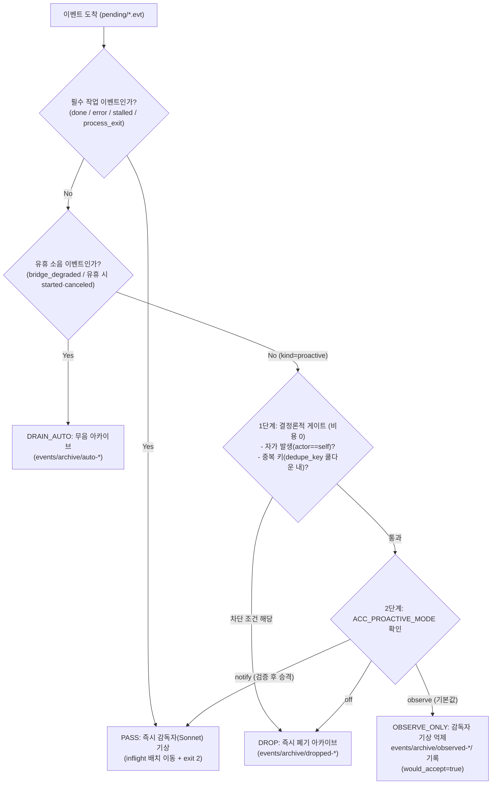
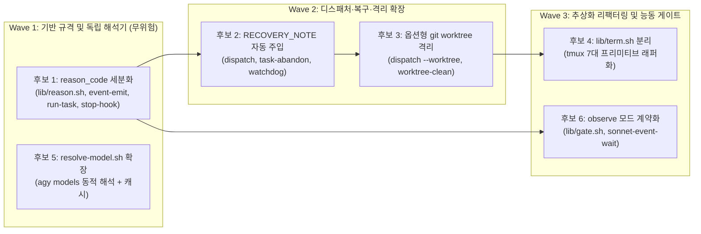

# 분산 에이전트 체인 6대 도입 후보 구체 구현 설계서 (IMPL-DESIGN-20261102)

> **상태**: 구현 완료 (v2.3)  
> **작성일**: 2026-11-02  
> **기반 문서**: `/home/rerun/agent-command-chain-template/docs/PRINCIPLES-structure-vs-implementation.md` (§6 도입 후보 6건)  
> **대상 코드베이스**: `/home/rerun/agent-command-chain-template` (`bin/`, `lib/`, `adapters/`, `bootstrap-v2.sh`, `watchdog-v2.sh`, `dashboard/server.py`, `tests/`)  
> **보호 대상 라이브 세션**: `agentchain-v4` (`instances/agentchain-v4.env`, `runtime/agentchain-v4-20261030`)

---

## 1. 설계 원칙 및 라이브 세션(`agentchain-v4`) 보호 제약

본 설계서는 `PRINCIPLES-structure-vs-implementation.md` 6장에서 도출된 6대 도입 후보를 현재 체인 코드에 바로 구현할 수 있도록 **파일·함수·줄 번호·스키마·테스트 수준**으로 구체화한 문서다. 모든 설계는 아래 4대 아키텍처 제약을 엄격히 준수한다.

1. **라이브 세션(`agentchain-v4`) 무중단·무오염 호환성**:
   - 현재 가동 중인 `agentchain-v4` 세션(`SESSION_NAME=agentchain-v4`, `ACC_RUNTIME=/home/rerun/agent-command-chain-template/runtime/agentchain-v4-20261030`, `AGY_MODE=resident`, `CODEX_MODE=oneshot`)을 재시작(`--restart`)하거나 기존 `tasks/*/state` 및 `events/*/*.evt` 파일을 마이그레이션하지 않아도 100% 동작해야 한다.
   - 모든 신규 파일 필드(`reason_code=`, `worktree_dir=`, `recovered_from=`)와 CLI 플래그(`--worktree`, `--recover-from`, `--harness`)는 **선택적(Optional) 확장**으로 설계하며, 생략 시 현재 동작과 바이트 단위로 동일하게 작동한다.
2. **복잡한 필수 절차 및 승인 단계 추가 금지**:
   - 다중 테넌트용 Admission Table, 상주 SQLite/Node.js 데몬, 필수 티켓 생성/종결 수동 명령 등 운영자와 감독자의 손발을 묶는 무거운 절차를 도입하지 않는다.
   - 기존 메커니즘(파일 기반 Outbox, 커널 `flock`, `state` 키=값 파일, `[CHAIN CONTEXT]` 프롬프트 헤더, `drain_noise()`)을 그대로 확장한다.
3. **무데몬·외부 의존성 제로 유지**:
   - 순수 Bash + POSIX 유틸리티(`flock`, `mv`, `awk`, `sed`, `grep`, `base64`) + Python 3 표준 라이브러리만 사용한다.
4. **격리 검증 우선 (`tests/lib-isolated-env.sh`)**:
   - 모든 변경 사항은 `LIVE_RT` 시그니처 불변 검증(`record_live_signature` / `verify_live_signature`)과 `TESTMARK` 오염 검사를 통과하는 격리 테스트로 검증한다.

### 1.1 6대 도입 후보 요약 매트릭스

| 번호 | 후보 항목 | 구분 | 핵심 변경 파일 | 기본값 (하위호환) | 라이브 `agentchain-v4` 재시작 필요 여부 |
| :---: | :--- | :---: | :--- | :--- | :---: |
| **1** | **`reason_code` 세분화** | 구조 계약 | `lib/reason.sh`(신규), `bin/event-emit.sh`, `bin/run-task.sh`, `bin/agy-stop-hook.sh`, `watchdog-v2.sh`, `bin/sonnet-event-wait.sh`, `dashboard/server.py` | 미지정 시 로그/센티널에서 자동 추론 (기존 `.evt` 파서 완벽 호환) | 불필요 (즉시 반영, `watchdog-v2`만 선택적 재기동) |
| **2** | **중단 작업 `RECOVERY_NOTE` 자동 주입** | 구조 계약 | `bin/dispatch.sh`, `bin/task-abandon.sh`, `watchdog-v2.sh`, `bin/chain-recover.sh` | 직전 작업 비정상 중단(`last_interrupted` 마커 존재) 시에만 자동 주입 (`ACC_NO_BRIEF_HEADER=1` 시 미주입) | 불필요 (다음 `dispatch.sh` 호출부터 즉시 동작) |
| **3** | **병렬 쓰기용 옵션형 `git worktree` 격리** | 구현 확장 | `bin/dispatch.sh`, `bin/run-task.sh`, `bin/sonnet-event-wait.sh`, `bin/worktree-clean.sh`(신규) | 비활성 (단일 `PROJECT_DIR` 유지, `--worktree` 명시 시에만 격리 생성) | 불필요 (온디맨드 CLI 플래그) |
| **4** | **`lib/term.sh` 분리 (`tmux` 얇은 래퍼)** | 구현 모듈화 | `lib/term.sh`(신규), `lib/session.sh`, `bin/dispatch.sh`, `bin/agy-stop-hook.sh`, `watchdog-v2.sh`, `bootstrap-v2.sh`, `bin/session-init.sh`, `bin/chain`, `bin/chain-recover.sh` | `ACC_TERM_BACKEND=tmux` (기존 `tmux` 명령 1:1 위임) | 불필요 (함수 래핑 치환, 런타임 상태 불변) |
| **5** | **`bin/resolve-model.sh`의 `agy` 모델 해석 확장** | 구현 확장 | `bin/resolve-model.sh`, `adapters/agy-oneshot.sh`, `config.env.example` | 1-인자 호출(`resolve-model.sh sol`) 시 기존 `codex` 동작 100% 유지 | 불필요 (독립 실행 스크립트) |
| **6** | **`observe` 모드 계약화 (`Rules-then-LLM`)** | 구조 계약 | `lib/gate.sh`(신규), `bin/event-emit.sh`, `bin/sonnet-event-wait.sh`, `config.env.example` | `ACC_PROACTIVE_MODE=observe` (`done`/`error`/`stalled`/`process_exit`는 항상 즉시 기상) | 불필요 (`sonnet-event-wait.sh` 다음 턴 기동 시 자동 반영) |

---

## 2. 후보 1: 종단 이벤트/센티널 사유 코드(`reason_code`) 세분화

### 2.1 (1) 변경 대상 파일·함수

1. **`lib/reason.sh` (신규 생성, 약 80줄)**
   - `acc_validate_reason_code <code>`: 입력 문자열이 허용된 `reason_code` 포맷(`^[a-z0-9_]{1,40}$`)인지 검증.
   - `acc_classify_reason_from_text <text> [default_code]`: 워커 출력 꼬리(`output.log` 마지막 30줄), `agy` 에러 메시지, 또는 `[[BLOCKED <id>]] reason=...` 문자열에서 결정론적 패턴 매칭으로 표준 `reason_code`를 반환하는 순수 함수.
   - `acc_normalize_blocked_reason <sentinel_rest>`: `[[BLOCKED <id>]]` 뒤의 텍스트에서 `reason=<토큰>`을 추출하고 표준 코드로 정규화.
2. **`bin/event-emit.sh`**
   - **인자 수신부 (5~11행)**: 선택적 7번째 인자 `reason_code="${7:-${ACC_REASON_CODE:-}}"` 수신 추가.
   - **페이로드 기록부 (65~75행)**: `.tmp` 이벤트 파일 생성 시 `printf 'reason_code=%s\n' "$reason_code"` 라인 추가.
3. **`bin/run-task.sh`**
   - **라이브러리 로드 (19행 직후)**: `source "$HERE/lib/reason.sh"` 추가.
   - **`write_state()` (48~74행)**: 선택적 3번째 인자 `reason_code="${3:-}"`를 받아 `state` 파일에 `printf 'reason_code=%s\n' "$reason_code"` 기록.
   - **`cleanup_on_signal()` (124~211행)**: 시그널 취소 이벤트(`sig_tmp`, 148~158행)에 `printf 'reason_code=interrupted\n'` 추가 및 `write_state "canceled" "$sig_term_id" "interrupted"` 호출.
   - **종단 판정 및 이벤트 생성부 (245~290행)**:
     - `rc == 0`: `term_kind="done"`, `term_reason_code="ok"` (단, `tail -n 15 "$log"`에 `^\s*\[\[BLOCKED\s+`가 존재하면 `acc_normalize_blocked_reason`으로 `term_reason_code` 설정).
     - `rc == 124 || rc == 137`: `term_kind="error"`, `term_reason_code="timeout"`.
     - `rc != 0`: `term_kind="error"`, `term_reason_code="$(acc_classify_reason_from_text "$(tail -n 30 "$log" 2>/dev/null || true)" "exec_error")"`.
     - `tmp_evt` 생성 블록(280~290행)에 `printf 'reason_code=%s\n' "$term_reason_code"` 추가, 350행 `write_state "$term_kind" "$term_event_id" "$term_reason_code"` 호출.
4. **`bin/agy-stop-hook.sh`**
   - **라이브러리 로드 (15행 직후)**: `HERE="$(cd "$(dirname "${BASH_SOURCE[0]}")/.." && pwd)"` 및 `source "$HERE/lib/reason.sh"` 로드.
   - **9단계 에러/중단 판정 (168~188행)**:
     - `term_reason`이 `timeout|max_steps_exceeded` → `reason_code="timeout"`
     - `term_reason`이 `interrupted|INTERRUPTED|cancel|cancelled|canceled|user_cancel*` → `reason_code="interrupted"`
     - 그 외 `error` 또는 `err_msg` 존재 시 → `reason_code="$(acc_classify_reason_from_text "${err_msg:-$term_reason}" "exec_error")"`
   - **10단계 센티널 판정 (344~385행)**:
     - `DONE` 분기(350~358행): `reason_code="ok"`
     - `BLOCKED` 분기(359~367행): `reason_code="$(acc_normalize_blocked_reason "$sentinel_rest")"`
     - 기한 초과 분기(373~377행): `reason_code="timeout"`
   - **11~12단계 발행 및 상태 갱신 (396~413행)**:
     - `export ACC_REASON_CODE="$reason_code"` 설정 후 `event-emit.sh` 호출.
     - `tmp_state` 기록 블록(407~412행)에서 `grep -vE '^(status|completed_epoch|terminal_event_id|reason_code)='` 처리 후 `printf 'reason_code=%s\n' "$reason_code"` 추가.
5. **`watchdog-v2.sh`**
   - **`write_task_state()` (206~256행)**: 선택적 6번째 인자 `new_reason_code="${6:-}"` (기존 파일의 `reason_code=` 보존 또는 신규 값 덮어쓰기) 추가.
   - **`check_running_tasks()` 내 PID 증발/상주 워커 크래시 회수 (453~466행)**: `ACC_REASON_CODE="worker_crash"` 주입 및 `write_task_state`에 `"worker_crash"` 전달.
   - **`check_running_tasks()` 내 Deadline 초과 처리 (569~576행, 628~631행)**: `ACC_REASON_CODE="timeout"` 주입 및 `write_task_state`에 `"timeout"` 전달.
   - **`check_running_tasks()` 내 SIGSTOP 감지 (644~646행)**: `ACC_REASON_CODE="stalled_sigstop"` 주입.
   - **`check_running_tasks()` 내 무출력 정체 감지 (703~705행)**: `ACC_REASON_CODE="stalled_no_output"` 주입.
6. **`bin/task-abandon.sh`**
   - **상태 갱신 및 취소 이벤트 발행 (144~191행)**: `state` 파일에 `reason_code=interrupted` 기록 및 `ACC_REASON_CODE=interrupted`로 `event-emit.sh` 호출.
7. **`bin/sonnet-event-wait.sh`**
   - **배치 메시지 생성 루프 (138~158행)**:
     - `.evt`에서 `rc_code=$(grep '^reason_code=' "$evt" 2>/dev/null | cut -d= -f2- || echo "")` 추출.
     - 이벤트 요약 줄 포맷: `rc_code`가 비어 있지 않으면 `reason=$rc_code`를 추가:
       `- [ID: <id>] kind=<knd> reason=<rc_code> worker=<src> task=<tid> exit=<ec>`
     - 배치 내 `reason_code=transient_quota` 이벤트가 1건 이상 존재하면 하단에 1줄 가이드 출력:
       `[HINT] reason=transient_quota 감지됨: 재시도 대신 대체 워커(codex ↔ agy)로 폴백 디스패치를 권장합니다.`
8. **`dashboard/server.py` & `bin/session-init.sh`**
   - `dashboard/server.py`: `parse_evt_file()`(206~214행) 반환 dict와 `collect_system_state()` 내 `tasks.append({...})`(463~473행)에 `"reason_code": kv.get("reason_code") or None` 필드 추가.
   - `bin/session-init.sh` (240~247행): 최근 `codex-*` 태스크의 `state` 파일에서 `reason_code=transient_quota` 여부를 먼저 검사하고, 없을 때만 기존 `output.log` 정규식 검사를 수행하도록 보강.

### 2.2 (2) 인터페이스 및 옵션

#### 표준 `reason_code` 어휘 및 분류 규칙

| `reason_code` | 적용 `kind` / `status` | 발생 조건 및 결정론적 매칭 규칙 (`lib/reason.sh`) | 감독자(Sonnet) 표준 대응 계약 |
| :--- | :--- | :--- | :--- |
| `ok` | `done` | 정상 완료 (`exit_code=0` & `[[DONE]]`) | 2층 감사(`output.log` / `git diff`) 후 완료 보고 |
| `transient_quota` | `error` | 로그/에러/센티널에 `429`, `Too Many Requests`, `rate_limit_exceeded`, `RESOURCE_EXHAUSTED`, `hit your usage limit`, `quota exceeded`, `usage limit`, `try again at` 매칭 시 | 동일 워커 재시도 금지 → 즉시 대체 워커(`codex` ↔ `agy`)로 동일 프롬프트 폴백 제안/재디스패치 |
| `transient_network` | `error` | `ECONNRESET`, `ETIMEDOUT`, `EAI_AGAIN`, `502 Bad Gateway`, `503 Service Unavailable`, `504 Gateway Timeout`, `overloaded_error`, `stream disconnected` 매칭 시 | 15~30초 후 동일 워커 1회 재디스패치 또는 대체 워커 전환 |
| `subagent_unavailable` | `error` | `[[BLOCKED <id>]]` 내 `reason=subagent-unavailable` 또는 `subagent_unavailable` | `ROLES.md` 규약에 따라 `codex` 창으로 재라우팅 |
| `needs_terra` | `error` | `[[BLOCKED <id>]]` 내 `reason=needs-terra` 또는 `needs_terra` | `codex` (Terra/Sol) 워커로 재라우팅 |
| `needs_human_decision` | `error` | `[[BLOCKED <id>]]` 내 `reason=ambiguous-spec`, `needs_human_decision` 또는 기타 미분류 `[[BLOCKED]]` | 인간에게 블로커 요약 및 의사결정 요청 |
| `verify_failed` | `error` | `[[BLOCKED <id>]]` 내 `reason=verify_failed` 또는 `test_failed` | 실패 로그 확인 후 수정 태스크 디스패치 |
| `timeout` | `error` / `stalled` | `run-task.sh` `rc=124\|137`, `agy-stop-hook.sh` 기한 초과, `watchdog-v2.sh` deadline 초과 | `task-abandon.sh` 회수 후 작업 분할 또는 `--timeout` 증액 재디스패치 (`RECOVERY_NOTE` 동반) |
| `stalled_no_output` | `stalled` | `watchdog-v2.sh` 무출력 `NO_OUTPUT_WARN_SECONDS` 초과 | 로그/트랜스크립트 점검 후 대기 또는 `task-abandon.sh` |
| `stalled_sigstop` | `stalled` | `watchdog-v2.sh` 프로세스 상태 `T`/`t` 감지 | 프로세스 상태 확인 (`kill -CONT` 또는 회수) |
| `worker_crash` | `process_exit` / `error` | `watchdog-v2.sh` PID 증발 또는 상주 TUI 종료 | 워커 창 상태 점검 후 재디스패치 (`RECOVERY_NOTE` 동반) |
| `host_restarted` | `abandoned` / `canceled` | `chain-recover.sh` 세션 재건 시 미완료 작업 정리 | 재디스패치 시 `RECOVERY_NOTE` 자동 주입 |
| `interrupted` | `canceled` / `abandoned` | `SIGINT`/`SIGTERM` 수신 또는 `task-abandon.sh` 실행 | 취소 확인 (의도된 취소면 종료, 재개 시 `RECOVERY_NOTE` 주입) |
| `exec_error` | `error` | 위 패턴에 해당하지 않는 일반 비정상 종료 (`rc != 0`) | `output.log` 열람 후 원인 분석 |

#### 파일 스키마 확장 (`.evt` 및 `tasks/<task_id>/state`)

```ini
# $ACC_RUNTIME/events/pending/<id>.evt (하위호환 키=값 포맷)
version=1
id=codex-1730512000000000000-terminal
source=codex
kind=error
reason_code=transient_quota
task_id=codex-1730512000000000000
created_epoch=1730512045
exit_code=1
summary_b64=...
detail_path_b64=...
```

```ini
# $ACC_RUNTIME/tasks/<task_id>/state
task_id=codex-1730512000000000000
worker=codex
status=error
reason_code=transient_quota
pid=12345
pgid=12345
proc_token=9876543
started_epoch=1730512000
deadline_epoch=1730513800
terminal_event_id=codex-1730512000000000000-terminal
```

### 2.3 (3) 하위호환 방식
- **기존 소비자 호환**: `sonnet-event-wait.sh`, `watchdog-v2.sh`, `dashboard/server.py`는 모두 줄 단위 `grep '^key='` 또는 `k, v = line.split("=", 1)`로 필요한 키만 읽는다. 따라서 새 키 `reason_code=`가 추가되어도 기존 파서는 단 한 줄도 깨지지 않는다.
- **구형 이벤트 호환**: `agentchain-v4`에 이미 존재하는 구형 `.evt`나 `state` 파일에 `reason_code=`가 없더라도, `sonnet-event-wait.sh`는 `reason_code`가 비어 있으면 기존 출력 포맷(`- [ID: ...] kind=... worker=... task=... exit=...`)을 그대로 출력하고, `dashboard/server.py`는 `"reason_code": None`을 반환한다.
- **`event-emit.sh` 호출 호환**: 기존 5~6개 위치 인자 호출(`event-emit.sh <source> <kind> <task_id> <summary> [detail_path] [custom_id]`)을 그대로 유지하며, `ACC_REASON_CODE` 환경변수나 7번째 인자가 없을 때는 `kind=done`이면 `ok`, `kind=canceled`이면 `interrupted` 등 기본값만 안전하게 채운다.

### 2.4 (4) 테스트 방법
- **신규 격리 테스트 스크립트 `tests/test_reason_code.sh` 작성** (`tests/lib-isolated-env.sh` 기반):
  1. **Case 1 (Quota 429 자동 분류)**: 스텁 `codex`가 `"Error: You have hit your usage limit. Please try again at 14:00."` 출력 후 `exit 1` 종료 시 `run-task.sh`가 생성한 `${task_id}-terminal.evt`와 `state`에 `reason_code=transient_quota`가 정확히 기록되는지 검증.
  2. **Case 2 (네트워크 오류 자동 분류)**: `"503 Service Unavailable / ECONNRESET"` 출력 후 `exit 1` 시 `reason_code=transient_network` 기록 검증.
  3. **Case 3 (`agy-stop-hook.sh` BLOCKED 사유 파싱)**: 트랜스크립트 마지막 모델 응답이 `[[BLOCKED task-1]] reason=subagent-unavailable`일 때 `reason_code=subagent_unavailable`, `reason=needs-terra`일 때 `reason_code=needs_terra`, 일반 `reason=스펙 확인 필요`일 때 `reason_code=needs_human_decision`으로 기록되는지 검증.
  4. **Case 4 (Watchdog 회수 사유)**: `watchdog-v2.sh --oneshot` 실행 시 죽은 PID 회수는 `reason_code=worker_crash`, 데드라인 초과는 `reason_code=timeout`, 무출력 스톨은 `reason_code=stalled_no_output`이 기록되는지 검증.
  5. **Case 5 (`sonnet-event-wait.sh` 배치 포맷 및 구형 `.evt` 호환)**: `reason_code=transient_quota`가 있는 `.evt`와 `reason_code`가 없는 구형 `.evt`를 함께 넣고 `sonnet-event-wait.sh` 실행 시 exit 2와 함께 두 이벤트 모두 정상 출력되는지 검증.
- **기존 스위트 회귀 검증**: `tests/stop-hook-test.sh` (19 케이스), `tests/watchdog-resident-test.sh`, `tests/dashboard-test.sh` 전건 통과 확인.

### 2.5 (5) 구현 순서·의존성
- **구현 순서**: **1순위 (Wave 1 첫 번째)**.
- **의존성**: 선행 의존성 없음. 반대로 **후보 2(`RECOVERY_NOTE`)**가 직전 중단 작업의 중단 원인(`prev_reason_code`)을 표시할 때 후보 1의 `reason_code`를 참조하므로 가장 먼저 구현한다.

---

## 3. 후보 2: 중단된 작업의 `RECOVERY_NOTE` 자동 주입

### 3.1 (1) 변경 대상 파일·함수

1. **`bin/task-abandon.sh`**
   - **중단 마커 기록부 (168~187행)**: `state` 파일을 `status=abandoned`로 갱신한 직후, 워커 이름이 식별되면(`agy` 또는 `codex`) `$runtime/workers/${worker}.last_interrupted` 파일을 원자적으로(`.tmp.$$` → `mv`) 생성:
     ```bash
     interrupted_file="$runtime/workers/${worker}.last_interrupted"
     {
       printf 'task_id=%s\n' "$task_id"
       printf 'status=abandoned\n'
       printf 'reason_code=%s\n' "${abandon_reason:-interrupted}"
       printf 'interrupted_epoch=%s\n' "$(date +%s)"
     } > "${interrupted_file}.tmp.$$"
     mv "${interrupted_file}.tmp.$$" "$interrupted_file"
     ```
2. **`watchdog-v2.sh`**
   - **`record_worker_interrupted()` 헬퍼 함수 신규 추가 (257행 직후)**:
     - 인자: `<worker> <task_id> <status> <reason_code>`
     - `$ACC_RUNTIME/workers/${worker}.last_interrupted`에 위와 동일한 포맷으로 원자적 기록.
   - **호출 지점 2곳**:
     1. `check_running_tasks()` 내 PID 증발/상주 워커 비정상 종료 reap 커밋 직후(480행, `final_status == "error"`일 때): `record_worker_interrupted "$worker" "$task_id" "error" "worker_crash"`
     2. `check_running_tasks()` 내 `WATCHDOG_AUTO_KILL=true` 데드라인 강제 종료 커밋 직후(590행): `record_worker_interrupted "$worker" "$task_id" "error" "timeout"`
3. **`bin/chain-recover.sh`**
   - **고아 running 태스크 정리부 추가 (45행 직후, `--dry-run` 분기 전)**:
     - 죽은 `tmux` 세션을 재건할 때 `$RT/tasks/*/state` 중 `status=running`인 태스크를 스캔하여, `$DRY`가 아니면 `state`를 `status=abandoned`, `reason_code=host_restarted`로 갱신하고 `workers/<worker>.busy`를 제거한 뒤 `workers/<worker>.last_interrupted`(`reason_code=host_restarted`)를 기록한다.
4. **`bin/dispatch.sh`**
   - **옵션 파서 확장 (42~70행)**:
     - `--recover-from <task_id>`: 특정 이전 태스크로부터 복구 노트 강제 주입.
     - `--no-recovery-note`: `.last_interrupted` 마커가 있어도 이번 디스패치에서 복구 노트 주입 생략(단, 마커는 정리).
   - **복구 컨텍스트 조립 블록 추가 (262~297행)**:
     - 조건: `[[ "${ACC_NO_BRIEF_HEADER:-0}" != "1" && "${ACC_NO_RECOVERY_NOTE:-0}" != "1" && "$no_recovery_note" == "false" ]]`
     - 대상 탐색:
       1. `--recover-from`이 지정된 경우: `$runtime/tasks/$recover_from/state`에서 `status`, `reason_code` 로드 (파일 부재 시 exit 66).
       2. 미지정된 경우: `$runtime/workers/$worker.last_interrupted` 파일이 존재하고 `interrupted_epoch`가 `RECOVERY_NOTE_TTL`(기본 86400초) 이내이면 해당 `task_id`, `status`, `reason_code` 로드.
     - 프롬프트 주입: `[CHAIN CONTEXT]` 블록 바로 아래(사용자 프롬프트 본문 위)에 `[RECOVERY NOTE]` 블록 삽입.
     - 상태 기록 및 마커 소비:
       - `state` 파일(상주 모드 327행) 또는 `task_dir/recovery.meta`(oneshot 모드 `run-task.sh`가 읽어 `state`에 합침)에 `recovered_from=$prev_task_id` 기록.
       - 디스패치 명령 주입이 최종 성공한 직후(357행, 374행) `$runtime/workers/$worker.last_interrupted` 파일을 삭제(`rm -f`)하여 다음 일반 작업에 중복 주입되지 않도록 보장(만약 `tmux send-keys` 실패 시에는 삭제하지 않아 재시도 시 보존).
5. **`bin/run-task.sh`**
   - **`write_state()` (48~74행)**: `$task_dir/recovery.meta`에 `recovered_from=`이 있으면 `state` 파일에 함께 기록.

### 3.2 (2) 인터페이스 및 옵션

#### CLI 옵션 및 환경변수 (`bin/dispatch.sh`)
- `bin/dispatch.sh <agy|codex> [--recover-from <prev_task_id>] [--no-recovery-note] ...`
- 환경변수:
  - `ACC_NO_RECOVERY_NOTE=1`: 자동 `RECOVERY_NOTE` 주입 비활성화 (기본값 `0`).
  - `RECOVERY_NOTE_TTL=86400`: `.last_interrupted` 마커 유효 시간(초, 기본 24시간).

#### 주입되는 `[RECOVERY NOTE]` 표준 포맷 (`$task_dir/prompt.md`)
```markdown
[CHAIN CONTEXT]
TEMPLATE_ROOT: /home/rerun/agent-command-chain-template
...
TASK_ID: codex-1730512100000000000
---
[RECOVERY NOTE]
PREV_TASK_ID: codex-1730512000000000000
PREV_STATUS: error (reason_code: worker_crash)
PREV_LOG: /home/rerun/agent-command-chain-template/runtime/.../tasks/codex-1730512000000000000/output.log
INSTRUCTION: 직전 작업(codex-1730512000000000000)이 완료되지 못하고 중단되었습니다. 파일 수정, 외부 명령 실행, git commit을 반복하기 전에 반드시 현재 작업 트리(`git status`, `git diff`, `git log -n 5`)와 직전 작업 로그/산출물을 먼저 확인하십시오. 이미 반영된 변경사항은 중복 실행하지 말고 남은 단계만 이어서 완료하십시오.
---
(사용자 원래 프롬프트 본문)
```

### 3.3 (3) 하위호환 방식
- **정상 흐름 시 변화 제로**: 직전 작업이 정상 완료(`done`)되었거나 일반 에러(`exec_error`, `transient_quota` 등 프로세스가 정상 종료하며 낸 에러)인 경우에는 `.last_interrupted` 마커가 생성되지 않으므로, 평소 `dispatch.sh`가 생성하는 `prompt.md`는 현재와 바이트 단위로 동일하다.
- **`ACC_NO_BRIEF_HEADER=1` 완전 보호**: `ACC_NO_BRIEF_HEADER=1`이 설정된 경우 `[RECOVERY NOTE]`도 절대 부착하지 않으므로 기존 `tests/dispatch-regression-test.sh`의 Test 2.2(`cmp -s "$orig_prompt" "$task_dir/prompt.md"`)가 100% 그대로 통과한다.
- **128KB 크기 가드 호환**: `[RECOVERY NOTE]`(약 450바이트)는 `dispatch.sh` 310행의 128KB(`131072`바이트) 크기 검증 **이전에** 조합되므로 `ARG_MAX` 보호 계약이 그대로 유지된다.

### 3.4 (4) 테스트 방법
- **신규 격리 테스트 스크립트 `tests/test_recovery_note.sh` 작성**:
  1. **Case 1 (`task-abandon.sh` → 자동 `RECOVERY_NOTE` 주입 및 1회 소비)**: 실행 중이던 죽은 PID 태스크 `agy-old-1`을 `bin/task-abandon.sh agy-old-1`로 포기 처리 → `workers/agy.last_interrupted` 생성 확인 → 후속 `dispatch.sh agy --prompt "Continue work"` 실행 → 생성된 `prompt.md`에 `[RECOVERY NOTE]`와 `PREV_TASK_ID: agy-old-1`이 포함되고 `workers/agy.last_interrupted`가 삭제되었는지 확인 → 세 번째 `dispatch.sh` 실행 시에는 `[RECOVERY NOTE]`가 더 이상 주입되지 않는지(1회 소비) 검증.
  2. **Case 2 (`watchdog-v2.sh` PID reap → 자동 `RECOVERY_NOTE` 주입)**: 죽은 PID를 가진 `running` 태스크를 `watchdog-v2.sh --oneshot`이 회수한 뒤 후속 `dispatch.sh` 시 `PREV_STATUS: error (reason_code: worker_crash)`가 주입되는지 검증.
  3. **Case 3 (`--recover-from <task_id>` 명시 지정)**: `.last_interrupted` 마커가 없어도 `--recover-from`으로 지정한 태스크 ID가 `[RECOVERY NOTE]`에 주입되고 `state`에 `recovered_from=`이 기록되는지 검증.
  4. **Case 4 (`--no-recovery-note` 및 `ACC_NO_BRIEF_HEADER=1` 억제)**: 마커가 존재할 때 `--no-recovery-note` 또는 `ACC_NO_BRIEF_HEADER=1`로 디스패치하면 `[RECOVERY NOTE]`가 주입되지 않는지 검증.

### 3.5 (5) 구현 순서·의존성
- **구현 순서**: **3순위 (Wave 2 첫 번째)**.
- **의존성**: 후보 1(`reason_code`)이 먼저 구현되어 있어야 `.last_interrupted`와 `[RECOVERY NOTE]`에 정확한 중단 사유 코드(`worker_crash`, `timeout`, `host_restarted`, `interrupted`)를 담을 수 있다.

---

## 4. 후보 3: 병렬 쓰기 작업용 옵션형 `git worktree` 격리

### 4.1 (1) 변경 대상 파일·함수

1. **`bin/dispatch.sh`**
   - **옵션 파서 확장 (42~70행)**:
     - `--worktree` (별칭 `--isolate`): 격리된 `git worktree` 생성 활성화 (`use_worktree=true`).
     - `--worktree-branch <branch_name>`: 사용할 브랜치명 지정 (미지정 시 `acc/$task_id`).
   - **Git 저장소 사전 검증 (92행 직후, 락 획득 전)**:
     - `use_worktree == true`일 때 `git -C "${PROJECT_DIR:-$PWD}" rev-parse --is-inside-work-tree >/dev/null 2>&1` 검사. 실패 시 `Error: --worktree requires PROJECT_DIR to be a valid git repository` 출력 후 `exit 65`.
     - `--worktree-branch`가 지정된 경우 `git check-ref-format --branch "$worktree_branch"`로 브랜치명 안전성 검증(실패 시 `exit 64`).
   - **Dry-run 출력 보강 (161~165행)**:
     - `use_worktree == true`이면 `[dry-run] Isolated git worktree would be created under $runtime/worktrees/<task_id> (base: $(git -C "${PROJECT_DIR:-$PWD}" rev-parse --short HEAD)).` 출력.
   - **Worktree 준비 함수 `prepare_task_worktree()` (260행 직후)**:
     - `wt_root="$runtime/worktrees"`, `wt_dir="$wt_root/$task_id"`, `wt_branch="${worktree_branch:-acc/$task_id}"`.
     - `mkdir -p "$wt_root"`
     - 베이스 커밋: `base_sha="$(git -C "$orig_project_dir" rev-parse HEAD 2>/dev/null)"`
     - 생성 실행:
       ```bash
       if ! timeout 120 git -C "$orig_project_dir" worktree add -b "$wt_branch" "$wt_dir" "$base_sha" >"$task_dir/worktree.log" 2>&1; then
         echo "Error: Failed to prepare isolated git worktree at $wt_dir (see $task_dir/worktree.log)" >&2
         git -C "$orig_project_dir" worktree remove --force "$wt_dir" >/dev/null 2>&1 || rm -rf "$wt_dir" 2>/dev/null || true
         git -C "$orig_project_dir" branch -D "$wt_branch" >/dev/null 2>&1 || true
         exit 73
       fi
       ```
     - 실패/시그널 롤백 가드: 프롬프트 크기 초과(exit 65) 또는 `tmux send-keys` 실패(exit 72)로 디스패치가 완주하지 못할 때 생성된 worktree를 정리하는 `rollback_worktree_on_abort()` 호출.
   - **프롬프트 헤더 및 실행 경로 바인딩 (265~375행)**:
     - `use_worktree == true`일 때 `[CHAIN CONTEXT]`에 아래 줄 포함:
       ```text
       PROJECT_DIR: <wt_dir>
       BASE_PROJECT_DIR: <orig_project_dir>
       WORKTREE_DIR: <wt_dir>
       WORKTREE_BRANCH: <wt_branch>
       WORKTREE_ISOLATION: active (반드시 WORKTREE_DIR 내부에서만 파일을 수정하고 BASE_PROJECT_DIR은 직접 수정하지 마라)
       ```
     - `task_dir/worktree.meta` 파일에 `worktree_dir=$wt_dir`, `worktree_branch=$wt_branch`, `base_project_dir=$orig_project_dir`, `base_sha=$base_sha` 기록.
     - **Resident 모드(`worker_mode == resident`)**: `state` 파일(327행)에 `worktree_dir=$wt_dir`, `worktree_branch=$wt_branch` 추가 기록.
     - **Oneshot 모드(`worker_mode == oneshot`)**: `run_cmd`(367행) 생성 시 5번째 인자 `$timeout` 뒤에 6번째 인자로 `"$wt_dir"` 전달:
       `run_cmd=$(printf '%q %q %q %q %q %q' "$HERE/bin/run-task.sh" "$worker" "$task_id" "$task_dir/prompt.md" "$timeout" "$wt_dir")`
2. **`bin/run-task.sh`**
   - **인자 수신부 (5~9행)**: `worktree_dir="${5:-}"` 추가 (미지정 시 빈 문자열, 기존 4-인자 호출과 100% 호환).
   - **`write_state()` (48~74행)**: `worktree_dir`이 비어 있지 않으면 `printf 'worktree_dir=%s\n' "$worktree_dir"` (및 `$task_dir/worktree.meta`의 `worktree_branch`) 기록.
   - **워커 프로세스 기동부 (225~227행)**:
     - `worktree_dir`이 존재하고 디렉터리이면 서브쉘에서 `PROJECT_DIR="$worktree_dir"`을 export하고 `cd "$worktree_dir"` 후 어댑터 실행:
       ```bash
       setsid bash -c '
         if [[ -n "$1" && -d "$1" ]]; then
           export PROJECT_DIR="$1"
           cd "$1" || exit 73
         fi
         shift
         exec "$@"
       ' _ "$worktree_dir" timeout --foreground --kill-after=10s "${timeout_s}s" "${adapter_cmd[@]}" > "$log" 2>&1 &
       ```
     - 이렇게 하면 `adapters/codex-oneshot.sh`는 `project_dir="${PROJECT_DIR:-$PWD}"`를 받아 `-C "$project_dir"`로 격리 워크트리에서 실행되고, `adapters/agy-oneshot.sh`도 격리 워크트리를 CWD로 실행된다(어댑터 파일 수정 불필요).
3. **`bin/sonnet-event-wait.sh`**
   - **배치 메시지 생성부 (138~153행)**:
     - 이벤트의 `task_id`에 대해 `$runtime/tasks/$tid/state`에 `worktree_dir=`이 있으면 배치 메시지에 아래 줄을 추가:
       `    worktree: <worktree_dir> (branch: <worktree_branch>)`
4. **`bin/worktree-clean.sh` (신규 유틸리티 스크립트, 약 90줄)**
   - 감독자가 격리 워크트리 결과를 `BASE_PROJECT_DIR`로 머지(`git merge` / `cherry-pick`)하거나 폐기한 뒤 안전하게 워크트리를 정리하는 도구.

### 4.2 (2) 인터페이스 및 옵션

#### 디스패치 및 정리 CLI
```bash
# 1. 병렬 쓰기 작업을 각기 다른 격리 worktree로 디스패치
SESSION_NAME=agentchain-v4 ./bin/dispatch.sh codex --worktree --prompt-file /tmp/task-a.md
SESSION_NAME=agentchain-v4 ./bin/dispatch.sh agy   --worktree --prompt-file /tmp/task-b.md

# 2. 커스텀 브랜치명 지정 디스패치
SESSION_NAME=agentchain-v4 ./bin/dispatch.sh codex --worktree --worktree-branch feat/auth-fix --prompt-file /tmp/task-a.md

# 3. 완료 후 감독자의 교차 감사 및 머지 (예시)
git -C "$ACC_RUNTIME/worktrees/<task_id>" status --short
git -C "$ACC_RUNTIME/worktrees/<task_id>" diff HEAD
git -C "$PROJECT_DIR" merge --no-ff "acc/<task_id>"

# 4. 워크트리 안전 정리 (미커밋 변경이 있으면 --force 없이 거부하여 산출물 유실 방지)
SESSION_NAME=agentchain-v4 ./bin/worktree-clean.sh <task_id> [--delete-branch] [--force]
SESSION_NAME=agentchain-v4 ./bin/worktree-clean.sh --prune-merged
```

#### 종료 코드 규약 (`dispatch.sh` & `worktree-clean.sh`)
- `64`: 잘못된 인자 또는 유효하지 않은 브랜치명
- `65`: `--worktree` 요청 시 `PROJECT_DIR`이 git 저장소가 아님
- `73`: `git worktree add` 초기화 실패 (`PrepareFailed` — 즉시 롤백 및 디스패치 중단)
- `1`: `worktree-clean.sh` 호출 시 미커밋 파일(dirty tree) 또는 미머지 커밋이 남아 있는데 `--force`가 없는 경우

### 4.3 (3) 하위호환 방식
- **옵션 미지정 시 동작 불변**: `--worktree`(`--isolate`)를 주지 않으면 `use_worktree=false`이므로, 단일 `PROJECT_DIR` 공유 방식이 현재와 100% 동일하게 동작한다.
- **`run-task.sh` 하위호환**: 5번째 인자 `[worktree_dir]`은 선택적 인자이므로 기존 4-인자 호출 테스트들과 완벽히 호환된다.
- **비-Git 프로젝트 호환**: 평소(`--worktree` 미사용)에는 `PROJECT_DIR`이 git 저장소가 아니어도 기존처럼 정상 디스패치된다(`codex-oneshot.sh`의 `--skip-git-repo-check` 유지).

### 4.4 (4) 테스트 방법
- **신규 격리 테스트 스크립트 `tests/test_worktree_isolation.sh` 작성**:
  1. **Case 1 (비-Git 디렉터리 거부)**: 일반 빈 폴더(`git init` 안 된 `$TEST_TMP/non_git`)에서 `dispatch.sh codex --worktree --dry-run` 호출 시 `exit 65` 반환 검증.
  2. **Case 2 (격리 Worktree 생성 및 Oneshot CWD 격리)**: 임시 git 리포지토리(`$TEST_TMP/repo`, 초기 커밋 1개) 생성 후 스텁 워커로 `dispatch.sh codex --worktree --prompt "touch isolated_file.txt"` 실행 → (a) `$TEST_RUNTIME/worktrees/$task_id`와 브랜치 `acc/$task_id`가 생성되었는지, (b) 스텁 워커가 만든 `isolated_file.txt`가 원본 `$TEST_TMP/repo`에는 없고 `$TEST_RUNTIME/worktrees/$task_id`에만 존재하는지, (c) `state` 파일에 `worktree_dir=`과 `worktree_branch=`가 기록되었는지 검증.
  3. **Case 3 (병렬 쓰기 무충돌 검증)**: `agy`(oneshot)와 `codex`(oneshot) 두 워커에 동시에 `--worktree`로 같은 파일(`shared.txt`)을 다르게 수정하고 `git commit`하는 작업을 병렬 실행 → `index.lock` 충돌 없이 두 작업 모두 `status=done`에 도달하고 각 브랜치(`acc/agy-*`, `acc/codex-*`)에 독립 커밋이 남는지 검증.
  4. **Case 4 (`worktree-clean.sh` 안전 가드 및 정리)**: 격리 워크트리에 미커밋 파일이 있을 때 `worktree-clean.sh <task_id>`가 거부(`exit 1`)하는지 확인 후, `--force --delete-branch`로 실행 시 디렉터리와 브랜치가 깔끔히 제거되고 `git worktree list`에 남지 않는지 검증.

### 4.5 (5) 구현 순서·의존성
- **구현 순서**: **4순위 (Wave 2 두 번째)**.
- **의존성**: 후보 4(`lib/term.sh`)와 독립적이나, `dispatch.sh`를 함께 수정하므로 후보 2(`RECOVERY_NOTE`) 직후에 이어서 구현하면 `dispatch.sh` 변경 충돌을 최소화할 수 있다.

---

## 5. 후보 4: `lib/term.sh` 분리 (`tmux` 호출 얇은 래퍼)

### 5.1 (1) 변경 대상 파일·함수

현재 체인 내 `tmux` 직접 호출 지점을 전수 조사한 결과(총 8개 핵심 실행 파일 + 테스트 하네스), 이를 `lib/term.sh`로 캡슐화한다. (레거시 v1 폴백용 `bootstrap.sh`, `watchdog.sh` 및 순수 tmux 세션 스위처 `bin/ts`, `bin/ts-tui`는 건드리지 않고 보존한다.)

| 대상 파일 | 기존 `tmux` 직접 호출 위치 (줄 번호) | `lib/term.sh` 치환 함수 |
| :--- | :--- | :--- |
| **`lib/term.sh` (신규)** | 멀티플렉서 추상화 단일 모듈 (`ACC_TERM_BACKEND=tmux\|herdr`) | 7대 핵심 프리미티브 + 세션/환경 보조 프리미티브 제공 |
| **`lib/session.sh`** | 15행 `list-windows`, 32·39행 `show-environment`, 82행 `list-sessions`, 131행 `display -p '#S'` | `term_has_window`, `term_get_env`, `term_list_sessions`, `term_current_session` |
| **`bin/dispatch.sh`** | 105행 `has-session`, 110행 `list-windows`, 142행 `display-message '#{pane_current_command}'`, 320행 `#{pane_pid}`, 351·368행 `send-keys -l` + `Enter`/`C-m` | `term_session_exists`, `term_pane_alive`, `term_fg_cmd`, `term_pane_pid`, `term_send_line`, `term_run_cmd` |
| **`bin/agy-stop-hook.sh`** | 35·44행 `${TMUX_PANE:-}`, 112~117행 `res_pane_id` vs `TMUX_PANE` 비교 | `term_current_pane_id`, `term_verify_resident_pane "$resident_marker"` |
| **`watchdog-v2.sh`** | 169행 `has-session`, 182·367행 `#{pane_current_command}`, 186행 `new-window`, 191·199행 `send-keys`, 298행 `TMUX_PANE="$res_pane"`, 546행 `send-keys C-c`, 859~861행 `set-buffer`/`paste-buffer` | `term_session_exists`, `term_fg_cmd`, `term_new_window`, `term_run_cmd`, `term_send_key ... C-c`, `term_paste_emergency` |
| **`bootstrap-v2.sh`** | 112행 `command -v tmux`, 220행 `list-windows`, 227·307·352행 `capture-pane`, 237·246·252행 `has-session`, 238행 `show-environment`, 248행 `kill-session`, 258행 `#{pane_pid}`, 265~266·394행 `#{pane_current_command}`, 289~374행 `new-session`/`new-window`/`send-keys`/`#{pane_id}`, 411~413행 `set-environment` | `term_require_cli`, `term_has_window`, `term_capture_tail`, `term_session_exists`, `term_get_env`, `term_kill_session`, `term_pane_pid`, `term_fg_cmd`, `term_new_session`, `term_new_window`, `term_run_cmd`, `term_send_line`, `term_send_key`, `term_write_resident_marker`, `term_set_env` |
| **`bin/session-init.sh`** | 104행 `list-panes -a`, 168~169·325행 `list-sessions`/`show-environment`, 360~361행 `#{pane_id}`/`#{pane_current_command}`, 381·435·444행 `send-keys`, 428~429행 `list-windows`/`new-window`, 443행 `capture-pane`, 453행 `#{pane_pid}` | `term_pid_to_loc_map`, `term_list_sessions`, `term_get_env`, `term_pane_id`, `term_fg_cmd`, `term_send_line`, `term_send_key`, `term_has_window`, `term_new_window`, `term_capture_tail`, `term_pane_pid` |
| **`bin/chain` & `bin/chain-recover.sh`** | `chain`: 12행 `has-session`, 13행 `show-environment`<br>`chain-recover.sh`: 38행 `has-session`, 53~61행 `new-session`/`set-environment`/`new-window`/`send-keys` | `term_session_exists`, `term_get_env`, `term_new_session`, `term_set_env`, `term_new_window`, `term_run_cmd` |

### 5.2 (2) 인터페이스 및 옵션 (`lib/term.sh` 규격)

#### 백엔드 선택 환경변수 (`config.env`)
- `ACC_TERM_BACKEND="${ACC_TERM_BACKEND:-${TERM_BACKEND:-tmux}}"` (기본값: `tmux`, 허용값: `tmux` | `herdr`)

#### 7대 핵심 프리미티브 시그니처 및 동작 명세 (`PRINCIPLES` §3.1)

```bash
# 1. 세션 존재 확인 (0=존재, 1=부재)
#    주의(Herdr 스파이크 §8): herdr status는 서버 미실행 시에도 exit 0을 반환하므로 출력의 'status: running'을 파싱
term_session_exists() {
  local sess="$1"
  [[ -z "$sess" ]] && return 1
  if [[ "${ACC_TERM_BACKEND:-tmux}" == "herdr" ]]; then
    herdr --session "$sess" status 2>/dev/null | grep -q 'status: running'
  else
    tmux has-session -t "$sess" 2>/dev/null
  fi
}

# 2. 페인/윈도우 생존 확인 (target 형식: "<session>:<window>" 또는 "<pane_id>")
term_pane_alive() {
  local target="$1"
  [[ -z "$target" ]] && return 1
  if [[ "${ACC_TERM_BACKEND:-tmux}" == "herdr" ]]; then
    local sess="${target%%:*}" pane="${target#*:}"
    herdr --session "$sess" pane get "$pane" >/dev/null 2>&1
  else
    if [[ "$target" == *:* ]]; then
      local sess="${target%%:*}" win="${target#*:}"
      tmux list-windows -t "$sess" -F '#{window_name}' 2>/dev/null | grep -qx "$win"
    else
      tmux display-message -p -t "$target" '#{pane_id}' >/dev/null 2>&1
    fi
  fi
}

# 3. 페인 루트(셸) PID 조회
term_pane_pid() {
  local target="$1"
  if [[ "${ACC_TERM_BACKEND:-tmux}" == "herdr" ]]; then
    local sess="${target%%:*}" pane="${target#*:}"
    herdr --session "$sess" pane process-info --pane "$pane" 2>/dev/null | \
      sed -nE 's/.*shell_pid=([0-9]+).*/\1/p' | head -n 1
  else
    tmux display-message -p -t "$target" '#{pane_pid}' 2>/dev/null
  fi
}

# 4. 상주형 워커에 안전한 1줄 도어벨 전송 (개행 문자 포함 시 인젝션 방지를 위해 즉시 거부 exit/return 1)
term_send_line() {
  local target="$1" text="$2"
  if [[ "$text" == *$'\n'* || "$text" == *$'\r'* ]]; then
    echo "[term_send_line] Error: multiline text rejected to prevent command injection" >&2
    return 1
  fi
  if [[ "${ACC_TERM_BACKEND:-tmux}" == "herdr" ]]; then
    local sess="${target%%:*}" pane="${target#*:}"
    herdr --session "$sess" pane send-text "$pane" "$text" && \
    herdr --session "$sess" pane send-keys "$pane" enter
  else
    tmux send-keys -l -t "$target" "$text" && tmux send-keys -t "$target" Enter
  fi
}

# 5. 단발성 셸 명령 기동 (1줄 명령 + C-m/Enter 제출)
term_run_cmd() {
  local target="$1" cmd="$2"
  if [[ "$cmd" == *$'\n'* || "$cmd" == *$'\r'* ]]; then
    echo "[term_run_cmd] Error: multiline command rejected" >&2
    return 1
  fi
  if [[ "${ACC_TERM_BACKEND:-tmux}" == "herdr" ]]; then
    local sess="${target%%:*}" pane="${target#*:}"
    herdr --session "$sess" pane run "$pane" "$cmd"
  else
    tmux send-keys -l -t "$target" "$cmd" && tmux send-keys -t "$target" C-m
  fi
}

# 6. 진단/신뢰 확인용 화면 꼬리 스냅샷 캡처
term_capture_tail() {
  local target="$1" lines="${2:-80}"
  if [[ "${ACC_TERM_BACKEND:-tmux}" == "herdr" ]]; then
    local sess="${target%%:*}" pane="${target#*:}"
    herdr --session "$sess" pane read "$pane" --lines "$lines" 2>/dev/null
  else
    tmux capture-pane -p -t "$target" -S "-${lines}" 2>/dev/null
  fi
}

# 7. 현재 훅/프로세스의 페인 ID 반환
term_current_pane_id() {
  if [[ "${ACC_TERM_BACKEND:-tmux}" == "herdr" ]]; then
    printf '%s' "${HERDR_PANE_ID:-}"
  else
    printf '%s' "${TMUX_PANE:-}"
  fi
}
```

#### 상주 워커 페인 소속 검증 함수 (`term_verify_resident_pane`)
Herdr 스파이크(`2026-10-31-herdr-spike-results.md` §4~5)에서 재현된 `pane_mismatch` 문제를 해결하면서 기존 `tmux` 가드(Requirement 2.1b)를 100% 보존한다:
- `workers/agy.resident` 파일 포맷:
  - `tmux` 백엔드(기존 포맷 그대로 유지): `pane_id=%1\nsession=agentchain-v4\n`
  - `herdr` 백엔드: `backend=herdr\npane_id=w1:p2\nsession=...\nsocket_path=...\n`
- `term_verify_resident_pane <marker_file>`:
  - 마커의 `backend=`가 `herdr`이면 `$HERDR_PANE_ID == pane_id && $HERDR_SESSION == session && $HERDR_SOCKET_PATH == socket_path` 3중 일치 검사.
  - 마커에 `backend=`가 없거나 `tmux`이면 기존과 완벽히 동일하게 `[[ -n "${TMUX_PANE:-}" && -n "$res_pane_id" && "$TMUX_PANE" == "$res_pane_id" ]]` 검사.

### 5.3 (3) 하위호환 방식
- **기본값 `ACC_TERM_BACKEND=tmux` 고정**: `config.env`나 인스턴스 env에 아무 설정이 없으면 `tmux` 분기가 선택되며, 내부적으로 기존과 동일한 `tmux` 서브커맨드와 플래그를 호출한다.
- **테스트 스파이(`TMUX_SPY_LOG`) 호환**: `tests/test-watchdog-runtime.sh`의 Test D는 `$TEST_BIN/tmux` 스파이 스크립트를 통해 `set-buffer -b acc-<session>`과 `paste-buffer -d -b acc-<session>` 호출을 검사한다. `term_paste_emergency()`의 `tmux` 분기가 정확히 동일한 `tmux set-buffer` / `tmux paste-buffer` 인자를 호출하므로 스파이 테스트가 무수정으로 100% 통과한다.
- **`agy-stop-hook.sh` Fail-Closed 보존**: `tests/stop-hook-test.sh` Case 12는 `agy-stop-hook.sh` 내에 `resolve_session_and_runtime` 문자열이 없는지 정적 검사한다. `lib/term.sh`는 `lib/session.sh`와 완전히 분리된 파일이므로 `agy-stop-hook.sh`가 `source "$HERE/lib/term.sh"`를 해도 Case 12가 완벽히 통과한다.

### 5.4 (4) 테스트 방법
- **신규 단위 테스트 스크립트 `tests/test_term_wrapper.sh` 작성**:
  1. **Case 1 (7대 프리미티브 tmux 백엔드 동작)**: 격리 tmux 세션에서 `term_session_exists`, `term_pane_alive`, `term_pane_pid`, `term_fg_cmd`, `term_send_line`, `term_run_cmd`, `term_capture_tail`, `term_current_pane_id` 호출 결과 검증.
  2. **Case 2 (개행 인젝션 방어 검증)**: `term_send_line` 및 `term_run_cmd`에 `printf 'line1\nline2'`(실제 LF 포함) 전달 시 즉시 `return 1`로 거부되고 타겟 페인에 아무것도 전송되지 않는지 검증.
  3. **Case 3 (Herdr 백엔드 목(Mock) 분기 검증)**: 가짜 `herdr` 바이너리 스텁을 `$TEST_BIN/herdr`에 두고 `ACC_TERM_BACKEND=herdr`일 때 `term_session_exists`(서버 `status: stopped` vs `status: running` 구분), `term_verify_resident_pane`(`HERDR_PANE_ID` + `HERDR_SESSION` + `HERDR_SOCKET_PATH` 일치 및 불일치 fail-closed) 검증.
- **전체 회귀 테스트**: `tests/run-all.sh --dirty-env-selfcheck` 11개 스위트 전건 통과 확인.

### 5.5 (5) 구현 순서·의존성
- **구현 순서**: **5순위 (Wave 3 첫 번째)**.
- **의존성**: 후보 1·2·3·5와 기능적 의존성은 없으나, `dispatch.sh`, `watchdog-v2.sh`, `agy-stop-hook.sh` 등 다수 파일의 `tmux` 호출부를 기계적으로 치환하므로, 후보 1·2·3의 비즈니스 로직 변경이 완료·검증된 뒤 순수 리팩터링 단계(Wave 3)로 적용하는 것이 diff 리뷰와 회귀 격리에 가장 안전하다.

---

## 6. 후보 5: `bin/resolve-model.sh`의 `agy` 모델 해석 확장

### 6.1 (1) 변경 대상 파일·함수

1. **`bin/resolve-model.sh` (전체 확장, 현재 82줄 → 약 190줄)**
   - **인자 파서 확장 (9~14행)**:
     - 기존 단일 인자 호출: `resolve-model.sh <tier>` (예: `resolve-model.sh sol`) → `harness="codex"`, `tier="$1"`로 처리.
     - 확장 플래그/인자 호출:
       - `resolve-model.sh --harness <codex|agy> <tier_or_role> [--effort <low|medium|high|xhigh>]`
       - 또는 2~3 위치 인자: `resolve-model.sh <codex|agy> <tier_or_role> [effort]`
   - **`resolve_codex_model <tier>` 함수 분리**:
     - 역할 별칭 매핑: `default` → `${CODEX_DEFAULT_TIER:-sol}`, `deep` → `${CODEX_DEEP_TIER:-terra}`, `fast` → `${CODEX_FAST_TIER:-sol}`. 그 외(`sol`, `terra` 등)는 그대로 `<tier>`로 사용.
     - 기존 라이브(`timeout 30 codex debug models`) → 캐시(`$CODEX_MODELS_CACHE`) 2단계 탐색 로직을 그대로 유지.
   - **`resolve_agy_model <tier_or_role> <effort>` 함수 신규 추가**:
     - 역할/티어 별칭 매핑:
       - `default` | `argon` → 패밀리 `gemini`, 티어 `argon`, 기본 effort `${AGY_DEFAULT_EFFORT:-high}`
       - `fast` | `flash` → 패밀리 `gemini`, 티어 `flash`, 기본 effort `${AGY_FAST_EFFORT:-high}`
       - `deep` | `review` | `opus` → 패밀리 `claude`, 티어 `opus`, 기본 effort `${AGY_DEEP_EFFORT:-high}`
       - `sonnet` → 패밀리 `claude`, 티어 `sonnet`, 기본 effort `${AGY_SONNET_EFFORT:-high}`
       - `oss` → 패밀리 `gpt-oss`, 티어 `120b`, 기본 effort `medium`
     - 라이브 조회 + 캐시 폴백:
       1. `command -v agy`가 있으면 `timeout 15 agy models 2>/dev/null` 실행.
       2. 실패하거나 출력이 비어 있으면 캐시 파일 `${AGY_MODELS_CACHE:-${HOME}/.gemini/antigravity-cli/cache/agy_models_cache.txt}` 읽기(캐시 파일 부재 시 `exit 66`).
     - Python 3 파서로 첫 번째 컬럼(모델 slug) 추출 후 정규식 버전 튜플 비교로 최고 버전 선택(매칭 모델 부재 시 `exit 1`).
2. **`adapters/agy-oneshot.sh`**
   - **모델 해석 연동 (19~21행)**:
     - `AGY_MODEL`이 직접 지정되어 있으면 `--model "$AGY_MODEL"` 추가.
     - `AGY_MODEL`이 비어 있고 `AGY_TIER`가 지정되어 있으면:
       ```bash
       HERE="$(cd "$(dirname "${BASH_SOURCE[0]}")/.." && pwd)"
       AGY_MODEL="$("$HERE/bin/resolve-model.sh" --harness agy "$AGY_TIER" --effort "${AGY_EFFORT:-high}")" || {
         echo "Error: cannot resolve agy model for tier '$AGY_TIER' (effort='${AGY_EFFORT:-high}')." >&2
         exit 65
       }
       ```
     - `AGY_MODEL`이 결정된 경우 `exec agy --dangerously-skip-permissions --model "$AGY_MODEL" -p "$prompt"`, 둘 다 미지정이면 기존과 동일하게 `exec agy --dangerously-skip-permissions -p "$prompt"` 실행.
3. **`config.env.example`**
   - `AGY_TIER`, `AGY_EFFORT`, `AGY_MODEL` 주석 예시 추가(기본값은 주석 처리하여 기존 동작 유지).

### 6.2 (2) 인터페이스 및 옵션

#### CLI 호출 규격 및 출력 예시 (`2026-11-02` 실측 `agy models` 카탈로그 기준)

| 호출 명령 | 하네스 | 해석 대상 (패밀리 / 티어 / 강도) | 출력 결과 (stdout) | 종료 코드 |
| :--- | :---: | :--- | :--- | :---: |
| `bin/resolve-model.sh sol` | `codex` | `gpt-<ver>-sol` (기존 100% 동일) | `gpt-5.6-sol` (카탈로그 최고 버전) | `0` |
| `bin/resolve-model.sh --harness codex default` | `codex` | `CODEX_DEFAULT_TIER` (`sol`) | `gpt-5.6-sol` | `0` |
| `bin/resolve-model.sh --harness agy default` | `agy` | `gemini-<ver>-argon-high` | `gemini-4-argon-high` | `0` |
| `bin/resolve-model.sh --harness agy argon --effort medium` | `agy` | `gemini-<ver>-argon-medium` | `gemini-4-argon-medium` | `0` |
| `bin/resolve-model.sh --harness agy fast` | `agy` | `gemini-<ver>-flash-high` | `gemini-3.8-flash-high` | `0` |
| `bin/resolve-model.sh --harness agy deep` | `agy` | `claude-opus-<ver>-high` | `claude-opus-5-5-high` | `0` |
| `bin/resolve-model.sh --harness agy sonnet --effort low` | `agy` | `claude-sonnet-<ver>-low` | `claude-sonnet-5-5-low` | `0` |
| `bin/resolve-model.sh agy opus high` | `agy` | 위치 인자 축약형 (`<harness> <tier> [effort]`) | `claude-opus-5-5-high` | `0` |

#### `agy models` 파싱 및 버전 튜플 비교 알고리즘
`agy models`의 각 줄 첫 번째 공백/탭 구분 토큰(`slug`)에 대해 아래 두 가지 명명 패턴을 모두 지원한다:
1. **Gemini형 (`<family>-<ver>-<tier>-<effort>`)**:
   - 정규식: `^gemini-(\d+(?:\.\d+)*)-([a-z0-9]+)-(low|medium|high|xhigh|max)$`
   - 예: `gemini-3.8-flash-high` → `ver=(3, 8)`, `tier="flash"`, `effort="high"`
   - 예: `gemini-4-argon-high` → `ver=(4,)`, `tier="argon"`, `effort="high"`
2. **Claude형 (`claude-<tier>-<ver_with_hyphens_or_dots>-<effort>`)**:
   - 정규식: `^claude-([a-z0-9]+)-(\d+(?:[.-]\d+)*)-(low|medium|high|xhigh|max)$`
   - 예: `claude-opus-5-5-high` → `tier="opus"`, `ver=(5, 5)`, `effort="high"`
- 요청된 `effort`가 해당 티어에 없으면(예: `high` 요청인데 카탈로그에 `medium`만 있는 경우), 요청 시 `--strict-effort`가 아닌 한 존재하는 가장 높은 effort(`max > xhigh > high > medium > low`)로 안전 폴백한다.

### 6.3 (3) 하위호환 방식
- **기존 `resolve-model.sh <tier>` 무결성**: 첫 번째 인자가 `--harness`나 `agy`/`codex`(2-인자 이상)가 아닌 단일 인자(`sol`, `terra` 등)일 때는 기존 코드 경로를 그대로 탄다.
- **종료 코드 규약 보존**: 잘못된 인자 문법(대문자, 특수문자, 빈 문자열 등)은 `exit 64`, 캐시 파일 부재는 `exit 66`, 매칭 티어 부재는 `exit 1`로 기존 `tests/test_resolve_model.sh`의 모든 단언(Assertion)을 100% 만족한다.
- **`adapters/agy-oneshot.sh` 기본 동작 불변**: `AGY_MODEL`과 `AGY_TIER`가 설정되지 않은 기본 상태에서는 `resolve-model.sh`를 호출하지 않고 기존 `exec agy --dangerously-skip-permissions -p "$prompt"`를 그대로 실행한다.

### 6.4 (4) 테스트 방법
- **`tests/test_resolve_model.sh` 확장 (Test 8 ~ Test 12 추가)**:
  1. **Test 1 ~ 7**: 기존 `codex` 테스트 무수정 통과 확인.
  2. **Test 8 (`agy` 라이브 출력 버전 비교)**: 가짜 `agy` 스텁이 `gemini-3.5-argon-high`, `gemini-4-argon-high`, `gemini-3.10-argon-high`를 출력할 때 `resolve-model.sh --harness agy default`가 `gemini-4-argon-high`를 선택하고, `claude-opus-4-6-high`와 `claude-opus-5-5-high` 중 `claude-opus-5-5-high`를 선택하는지 검증.
  3. **Test 9 (`agy` 역할 별칭 및 `--effort` 지정)**: `fast` → `gemini-3.8-flash-high`, `deep` → `claude-opus-5-5-high`, `argon --effort low` → `gemini-4-argon-low` 선택 검증.
  4. **Test 10 (`agy` 라이브 실패 시 `AGY_MODELS_CACHE` 폴백)**: 가짜 `agy`가 `exit 1`일 때 `AGY_MODELS_CACHE` 파일에서 정상 해석되는지 검증.
  5. **Test 11 (`agy` 캐시 파일 부재 시 `exit 66`, 미존재 티어 `exit 1`)**: 실패 종료 코드 규약 검증.

### 6.5 (5) 구현 순서·의존성
- **구현 순서**: **2순위 (Wave 1 두 번째)**.
- **의존성**: 다른 5개 후보와 완전히 독립된 유틸리티 계층이므로 Wave 1에서 후보 1과 함께 즉시 구현·검증할 수 있다.

---

## 7. 후보 6: `observe` 모드 계약화 (`Rules-then-LLM` 결정론적 게이트)

### 7.1 (1) 변경 대상 파일·함수

1. **`lib/gate.sh` (신규 생성, 약 110줄 — `Rules-then-LLM` 결정론적 게이트 및 `observe` 감사 로거)**
   - `acc_gate_evaluate_event <evt_file> <runtime>`:
     - 입력된 `.evt` 파일의 `source`, `kind`, `task_id`, `actor`, `dedupe_key`를 읽어 LLM(감독자)을 깨우기 전 비용 0의 결정론적 판정을 내리는 함수.
     - 반환(출력) 판정 코드:
       - `PASS`: 감독자(Sonnet)에게 즉시 전달 (`done`, `error`, `stalled`, `process_exit`, 그리고 `ACC_PROACTIVE_MODE=notify`를 통과한 `proactive` 이벤트).
       - `DRAIN_AUTO`: 기존 `drain_noise` 대상 (`bridge_degraded`, 또는 체인 유휴 시의 `started`/`canceled`) → `events/archive/auto-<ts>/`로 무음 이동.
       - `DROP_SELF`: 자가 발생 이벤트 (`actor`가 `${ACC_SELF_ACTOR:-agentchain}`과 일치) → `events/archive/dropped-<date>/`로 이동 (`gate_decision=dropped_self_echo`).
       - `DROP_DEDUPE`: 동일 `dedupe_key`가 `PROACTIVE_DEDUPE_WINDOW`(기본 3600초) 내 `$runtime/events/dedupe/`에 이미 존재 → `events/archive/dropped-<date>/`로 이동 (`gate_decision=dropped_duplicate`).
       - `DROP_OFF`: `kind=proactive`인데 `ACC_PROACTIVE_MODE=off`인 경우 → `events/archive/dropped-<date>/`로 이동 (`gate_decision=proactive_off`).
       - `OBSERVE_ONLY`: `kind=proactive`이고 결정론적 게이트(자가 발생 아님, 중복 아님)를 통과했으나 `ACC_PROACTIVE_MODE=observe`(기본값)인 경우 → **감독자를 깨우지 않고** `$runtime/events/archive/observed-<YYYYMMDD>/` 아래에 감사 로그(`would_accept=true`)와 함께 아카이빙!
   - `acc_gate_archive_observed <evt_file> <runtime> <rule_id>`:
     - 원본 `.evt` 파일을 `$runtime/events/archive/observed-$(date +%Y%m%d)/`로 원자적 이동하고, 같은 디렉터리의 `observed-audit.jsonl`에 1줄 JSON 감사 레코드(`timestamp`, `event_id`, `source`, `task_id`, `rule_id`, `would_accept: true`, `mode: "observe"`, `summary`)를 기록한다.
2. **`bin/event-emit.sh`**
   - **허용 `source` 및 `kind` 확장 (34~37행)**:
     - `source_name`: 기존 `agy|codex|watchdog|bridge`에 `poller|cron|external` 추가.
     - `kind`: 기존 `started|done|error|canceled|stalled|process_exit|bridge_degraded`에 `proactive` 추가.
   - **선택적 게이트 메타데이터 환경변수 지원 (65~75행)**:
     - `ACC_EVENT_ACTOR`, `ACC_DEDUPE_KEY`, `ACC_RULE_ID` 환경변수가 설정된 경우 `.evt` 파일에 `actor=`, `dedupe_key=`, `rule_id=` 줄을 함께 기록.
3. **`bin/sonnet-event-wait.sh`**
   - **라이브러리 로드 (10행 직후)**: `source "$HERE/lib/gate.sh"` 추가.
   - **`drain_noise()` 함수를 `apply_deterministic_gate()`로 승격 (80~97행, 기존 함수명 `drain_noise`는 별칭으로 유지)**:
     - `pending/*.evt`를 순회하며 `acc_gate_evaluate_event`를 호출:
       - `PASS`: `pending/`에 그대로 남겨 감독자 기상 배치로 진입.
       - `DRAIN_AUTO`: 기존과 동일하게 `archive/auto-<ts>/`로 이동.
       - `OBSERVE_ONLY`: `acc_gate_archive_observed` 호출하여 감독자를 깨우지 않고 `archive/observed-<YYYYMMDD>/`에 기록.
       - `DROP_*`: `archive/dropped-<YYYYMMDD>/`로 무음 이동.
   - **배치 메시지 생성 시 `kind=proactive` 안전 가드 (138~158행)**:
     - `ACC_PROACTIVE_MODE=notify`로 승격되어 `kind=proactive` 이벤트가 배치에 포함된 경우, 배치 메시지 상단에 명시적 가드 문구 출력:
       `[PROACTIVE_TRIGGER_NOTICE] 능동 감지 이벤트가 포함되어 있습니다. "논의 ≠ 승인" 원칙에 따라 사용자 승인 없이 자동 dispatch 하지 말고 후보만 보고하십시오.`
4. **`config.env.example`**
   - 능동성 제어 기본 설정 추가:
     ```ini
     # 능동적 트리거(Proactive Source/Cron) 자율성 단계 제어
     # off     : 모든 kind=proactive 이벤트 폐기
     # observe : (기본 권장) 결정론적 게이트 통과 시 감독자를 깨우지 않고 events/archive/observed-* 에 would_accept=true 만 기록
     # notify  : 결정론적 게이트 통과 시 감독자(Sonnet)에게 알림 전달 (단, 인간 승인 전 자동 dispatch 금지)
     ACC_PROACTIVE_MODE=observe
     ```

### 7.2 (2) 인터페이스 및 옵션

#### 능동적 이벤트 발행 인터페이스 (`bin/event-emit.sh`)
```bash
# 외부 폴러(GitHub CI/PR)나 주기적 점검 크론이 후보 이벤트를 발행하는 표준 방법
ACC_RULE_ID="ci-failure-check" \
ACC_DEDUPE_KEY="pr-42-sha-9f8e7d" \
ACC_EVENT_ACTOR="github-actions[bot]" \
SESSION_NAME=agentchain-v4 \
./bin/event-emit.sh poller proactive "pr-42" "CI check failed on PR #42 (lint error)" "/path/to/ci.log"
```

#### `observe` 모드 감사 로그 스키마 (`$ACC_RUNTIME/events/archive/observed-<YYYYMMDD>/observed-audit.jsonl`)
```json
{"timestamp":"2026-11-02T11:00:00Z","event_id":"1730512800000000000-poller-999","source":"poller","kind":"proactive","task_id":"pr-42","rule_id":"ci-failure-check","dedupe_key":"pr-42-sha-9f8e7d","actor":"github-actions[bot]","mode":"observe","would_accept":true,"reason":"observed_only","summary":"CI check failed on PR #42 (lint error)"}
```

#### `Rules-then-LLM` + `observe` 상태 전이 흐름도



### 7.3 (3) 하위호환 방식
- **필수 작업 이벤트 절대 불변**: `done`, `error`, `stalled`, `process_exit`는 `ACC_PROACTIVE_MODE` 값(`off`/`observe`/`notify`)과 무관하게 무조건 `PASS`로 판정되어 기존과 100% 동일하게 감독자를 깨운다.
- **기존 `drain_noise()` 완벽 보존**: `started`, `canceled`, `bridge_degraded`의 처리 조건(`status=running` 유무 확인 및 `archive/auto-*` 이동)은 기존 코드(80~97행)와 한 치의 오차도 없이 동일하다.
- **보존 정책(`event-ack.sh`) 호환**: `observed-<YYYYMMDD>` 및 `dropped-<YYYYMMDD>`는 모두 `$runtime/events/archive/` 하위 1단계 디렉터리로 생성되므로, `event-ack.sh`(44~54행)의 7일 경과 / 1,000개 초과 자동 정리 로직이 수정 없이 그대로 관리해 준다.

### 7.4 (4) 테스트 방법
- **신규 격리 테스트 스크립트 `tests/test_observe_gate.sh` 작성**:
  1. **Case 1 (`observe` 모드 기본 동작 — 기상 억제 및 `would_accept=true` 기록)**: `ACC_PROACTIVE_MODE=observe`(기본값)에서 `event-emit.sh poller proactive "pr-10" "Test proactive"` 발행 후 게이트 실행 시, `pending/`에서 사라지고 `archive/observed-*/observed-audit.jsonl`에 `"would_accept":true`가 기록되며 감독자는 깨어나지 않는지(타임아웃 내 `exit 2` 미발생) 검증.
  2. **Case 2 (`observe` 모드 중에도 `done`/`error`는 즉시 기상)**: `proactive` 이벤트와 `done` 이벤트를 동시에 `pending/`에 넣었을 때, `proactive`는 `archive/observed-*/`로 빠지고 `done` 이벤트만 `inflight/<batch>/`로 선점되어 `sonnet-event-wait.sh`가 `exit 2`로 즉시 깨어나는지 검증.
  3. **Case 3 (결정론적 게이트 — 자가 발생 및 중복 `dedupe_key` 차단)**:
     - `ACC_EVENT_ACTOR="agentchain"`(자가 발생) 이벤트가 `DROP_SELF`로 차단되어 `observed-audit.jsonl`에도 오르지 않는지 검증.
     - 동일 `ACC_DEDUPE_KEY="ci-123"`을 2회 연속 발행 시 첫 번째만 기록되고 두 번째는 `DROP_DEDUPE`로 차단되는지 검증.
  4. **Case 4 (`notify` 모드 승격 시 기상 및 가드 문구 포함)**: `ACC_PROACTIVE_MODE=notify` 설정 시 게이트를 통과한 `proactive` 이벤트가 `exit 2`와 함께 `[PROACTIVE_TRIGGER_NOTICE]` 가드 문구를 포함하여 전달되는지 검증.

### 7.5 (5) 구현 순서·의존성
- **구현 순서**: **6순위 (Wave 3 두 번째)**.
- **의존성**: 후보 1(`reason_code`)에서 확장한 `bin/event-emit.sh`와 `bin/sonnet-event-wait.sh` 위에 얹히므로 후보 1 이후에 구현한다.

---

## 8. 전체 구현 순서·의존성 로드맵 및 라이브 적용 절차

### 8.1 후보 간 의존성 그래프



### 8.2 단계별(Wave 1 → 2 → 3) 구현 순서 및 근거

1. **Wave 1 (기반 구축): [후보 1: `reason_code` 세분화] + [후보 5: `resolve-model.sh` 확장]**
   - **근거**: 후보 5는 다른 스크립트와 결합도가 0인 독립 도구이며, 후보 1은 이벤트(`.evt`)와 작업 상태(`state`)의 스키마를 정의하여 후보 2(`RECOVERY_NOTE`)와 후보 6(`observe` 게이트)의 기반이 된다.
   - **검증 게이트**: `tests/test_resolve_model.sh`, `tests/test_reason_code.sh`, `tests/stop-hook-test.sh` 통과.
2. **Wave 2 (작업 수명주기 및 격리 확장): [후보 2: `RECOVERY_NOTE` 자동 주입] → [후보 3: 옵션형 `git worktree` 격리]**
   - **근거**: 두 후보 모두 `bin/dispatch.sh`와 `bin/run-task.sh`를 수정한다. 후보 2를 먼저 넣은 뒤 후보 3을 연속으로 구현하면 `dispatch.sh`의 프롬프트 조립부(`[CHAIN CONTEXT]` → `[RECOVERY NOTE]` → 본문)와 `state` 기록부를 충돌 없이 한 번에 정돈할 수 있다.
   - **검증 게이트**: `tests/test_recovery_note.sh`, `tests/test_worktree_isolation.sh`, `tests/dispatch-regression-test.sh`, `tests/test_task_abandon.sh` 통과.
3. **Wave 3 (모듈 추상화 및 능동성 계약): [후보 4: `lib/term.sh` 분리] + [후보 6: `observe` 모드 계약화]**
   - **근거**: 후보 4는 8개 파일의 `tmux` 호출을 `lib/term.sh` 함수로 치환하는 구조적 리팩터링이므로, Wave 1~2의 기능 변경이 끝난 상태에서 수행해야 기능 버그와 래퍼 치환 버그를 명확히 분리할 수 있다. 후보 6은 `sonnet-event-wait.sh`의 `drain_noise()`를 `lib/gate.sh`로 확장하여 마무리한다.
   - **최종 검증 게이트**: 신규 테스트 5종 + 기존 `tests/run-all.sh --dirty-env-selfcheck` 전 스위트 100% 통과 및 `LIVE_RT` 무오염 확인.

### 8.3 라이브 세션(`agentchain-v4`) 무중단 반영 지침

| 컴포넌트 | 반영 시점 및 방식 | `agentchain-v4` 세션 중단 여부 |
| :--- | :--- | :---: |
| `bin/dispatch.sh`, `bin/run-task.sh`, `bin/event-emit.sh`, `bin/resolve-model.sh`, `bin/task-abandon.sh`, `bin/worktree-clean.sh` | 단발 실행 스크립트이므로 파일 수정 즉시 다음 호출부터 자동 적용됨 | **무중단 (0초)** |
| `bin/agy-stop-hook.sh` | 상주 `agy`가 턴을 마칠 때마다 새로 fork되어 실행되므로 파일 수정 즉시 다음 턴 완료부터 자동 적용됨 | **무중단 (0초)** |
| `bin/sonnet-event-wait.sh` | 현재 대기 중인 프로세스가 다음 이벤트를 처리하고 종료(`exit 2`)한 뒤, Claude Code가 다음 훅을 걸 때 새 스크립트로 자동 교체됨 | **무중단 (자동 회전)** |
| `watchdog-v2.sh` | 기존 워치독 프로세스가 돌아가고 있어도 무해하나, 신규 `reason_code` 및 `.last_interrupted` 기록을 워치독에서도 즉시 활성화하려면 유휴 시점에 기존 `watchdog.pid`에만 `kill -TERM` 후 동일 환경변수로 백그라운드 재기동 (tmux 세션/창에는 영향 없음) | **무중단 (백그라운드 데몬만 교체 가능)** |
