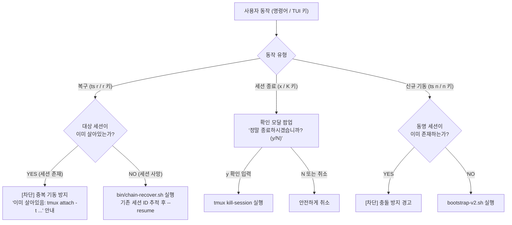

# `ts` — TMUX 세션 관리자 & 에이전트 체인 통합 제어 툴킷

> **`ts`**는 개발자 및 운영자가 tmux 기반 멀티 에이전트 체인 세션에 **단 한 글자의 입력(`ts 1`, `ts r` 등)**만으로 즉시 접속하고, 비정상 종료된 세션을 원클릭 복구하며, 모바일/SSH 터미널 환경에서도 직관적으로 모니터링할 수 있도록 설계된 **Tokyo Night 스타일 반응형 TUI & 통합 CLI 도구**입니다.

---

## 1. 개요 및 핵심 기능

멀티 에이전트 체인(`agent-command-chain-template`)은 복수의 백그라운드 프로세스(Claude Sonnet 감독자, agy/codex 워커, watchdog 안전망)가 상호작용하는 구조로 동작합니다. 하지만 터미널 작업 중 복잡한 `tmux attach -t ...`, 복구 스크립트 실행, 세션 상태 조회를 일일이 수행하는 것은 번거롭습니다.

`ts`는 이러한 일상 작업을 극도로 단순화합니다:
- **초고속 번호 접속**: `ts 1` 한 번으로 목록의 1번 세션에 즉각 진입.
- **Tokyo Night TUI 매니저**: btop, lazygit, k9s를 벤치마킹한 유려하고 세련된 터미널 UI 기본 제공.
- **체인 원클릭 복구 (`ts recover` / `ts r`)**: 비정상 종료된 Claude 감독자 세션을 기존 세션 ID 기반 `--resume` 및 `--remote-control`로 안전 복구.
- **신규 체인 일괄 기동 (`ts new` / `ts n`)**: 런타임/FIFO 및 Full-Push 3대 윈도우, 워치독 자동 기동.
- **모바일/Termux 최적화**: 좁은 화면(스마트폰 SSH, 태블릿) 3단계 반응형 뷰포트 + 두벌식 한글 자동 키 매핑.
- **Zero-Dependency**: 외부 라이브러리(`pip`) 설치 없이 Python 3 내장 `curses`와 순수 Bash만으로 동작.

---

## 2. 설치 및 환경 설정

### 2.1 빠른 설치 (권장)
제공되는 설치 스크립트를 통해 `~/bin/ts`에 심볼릭 링크를 원클릭으로 구성합니다.

```bash
# 저장소 루트 또는 tools/ts 디렉토리에서 실행
./tools/ts/install.sh
```

### 2.2 수동 설치
수동으로 심볼릭 링크를 등록하려면 다음 명령을 실행합니다:

```bash
# 1. ~/bin 디렉토리 생성
mkdir -p ~/bin

# 2. 심볼릭 링크 연결 (저장소 bin/ts 대상)
ln -sf /home/rerun/agent-command-chain-template/bin/ts ~/bin/ts

# 3. PATH 환경변수 등록 (필요시 ~/.bashrc 에 추가)
echo 'export PATH="$HOME/bin:$PATH"' >> ~/.bashrc
source ~/.bashrc
```

### 2.3 시스템 요구사항
- **OS**: Linux (WSL2, Ubuntu, Debian, Alpine 등)
- **런타임**:
  - `bash` (4.0 이상 권장)
  - `tmux` (2.6 이상 권장)
  - `python3` (3.8 이상, 내장 `curses` 라이브러리 기본 포함)
- **외부 패키지**: **추가 `pip install` 요구사항 전혀 없음** (표준 라이브러리만 사용)

---

## 3. CLI 명령어 치트시트

`ts`는 인자 유무와 서브커맨드에 따라 최적의 동작을 자동 선택합니다.

| 명령어 | 단축형 | 동작 설명 |
|---|---|---|
| `ts` | - | 대화형 **Tokyo Night TUI 매니저** 기동 (기본 권장) |
| `ts <번호>` | `ts 1` | 활성 세션 목록의 지정 번호 세션에 즉시 접속 (`attach`) |
| `ts <세션명>` | `ts agentchain-v3` | 지정한 세션명으로 즉시 접속 (`attach`) |
| `ts attach <세션\|번호>` | `ts a 1` | 명시적 세션 접속 (tmux 내부 실행 시 `switch-client` 자동 수행) |
| `ts recover [세션]` | `ts r [세션]` | 비정상 종료된 체인 복구 (Claude 감독자 단독 + Remote Control 재개) |
| `ts new [세션]` | `ts n [세션]` | 신규 체인 전체 기동 (`bootstrap-v2.sh` 기반 Full-Push 윈도우 일괄 생성) |
| `ts list` | `ts ls`, `ts l` | 현재 활성 tmux 세션 및 에이전트 체인 런타임 상태 텍스트 출력 |
| `ts help` | `ts -h`, `ts --help` | CLI 사용법 및 단축키 안내 출력 |
| `ts --no-tui` | - | TUI 그래픽을 건너뛰고 가벼운 텍스트 기반 대화형 번호 선택 메뉴 강제 실행 |
| `ts tui` | - | 명시적으로 Tokyo Night TUI 매니저 실행 |

> [!TIP]
> **tmux 세션 내부에서의 동작**: tmux 윈도우 안에서 `ts <번호>`를 입력하면 중첩 접속 경고 없이 자동으로 `tmux switch-client`가 실행되어 대상 세션으로 매끄럽게 창을 전환합니다.

---

## 4. Tokyo Night TUI 디자인 및 인터페이스

`ts`의 TUI 엔진(`bin/ts-tui`)은 현대적 TUI 도구(btop, lazygit, k9s, zellij)의 모범 사례를 계승했습니다.

### 4.1 화면 레이아웃 (데스크톱 모드: 폭 >= 70)
```
╭─ [1] TMUX 세션 목록 (3) ──────────────────────────╮╭─ [2] 세션 상세 정보: agentchain-v3 ────────────────╮
│ ● [1] agentchain-v3        (창 4개) [접속중] 10/15 ││ • 세션명: agentchain-v3  상태: active  윈도우: 4개   │
│ ○ [2] maintboard-8090      (창 1개) [대기중] 10/16 ││ • 윈도우 구성:                                    │
│ ○ [3] scheduler-prod-8088  (창 1개) [대기중] 10/16 ││   - 0: sonnet* (claude --model sonnet --rc)        │
│                                                    ││   - 1: agy (bash)                                  │
│                                                    ││   - 2: codex (codex)                               │
│                                                    ││   - 3: lead (bash)                                 │
│                                                    ││ • 런타임: /home/rerun/.../runtime/agentchain-v3-20261012│
╰────────────────────────────────────────────────────╯╰────────────────────────────────────────────────────╯
╭─ 키 가이드 ──────────────────────────────────────────────────────────────────────────────────────────────╮
│ [Enter] 접속  [r] 체인복구  [n] 체인기동  [d] 상세  [x/K] 세션종료  [R/F5] 새로고침  [Tab] 전체화면  [q] 종료 │
╰──────────────────────────────────────────────────────────────────────────────────────────────────────────╯
```

1. **좌측 세션 목록 (Session List)**:
   - 번호 색인, 세션 이름, 윈도우 수, 실시간 상태 인디케이터(● 녹색: 접속 중, ○ 청색: 대기 중).
2. **우측 세션 상세 (Session Detail & Inspection)**:
   - 각 창의 인덱스, 윈도우명, 포그라운드 프로세스 명령.
   - 체인 런타임 경로, 워치독 PID, FIFO 리스너 PID, 미처리 작업(pending/busy) 수치.
   - Claude Remote Control 연결 링크 및 가이드 표시.
3. **하단 상시 키 안내 (Key Guide)**:
   - 현재 선택된 항목의 맥락에 맞춘 직관적인 단축키 및 동작 가이드.

### 4.2 Tokyo Night 컬러 팔레트
- **배경 / 테두리**: Dark Slate (`#1a1b26`), 라운드 박스(`╭─╮╰─╯`)
- **강조 / 타이틀**: Soft Cyan / Sky Blue (`#7aa2f7`)
- **활성 상태 / 태그**: Emerald Green (`#9ece6a`)
- **선택 커서**: Deep Blue 배경 하이라이트
- **경고 / 단축키**: Bright Yellow / Amber (`#e0af68`)
- **위험 / 삭제 확인**: Crimson Red (`#f7768e`)

### 4.3 TUI 단축키 일람

| 단축키 | 보조 키 | 기능 | 설명 |
|---|---|---|---|
| `Enter` | `Space` | **세션 접속** | 선택한 tmux 세션으로 즉시 `attach` (또는 `switch-client`) |
| `r` | `ㄱ` | **체인 복구** | 죽은 세션 복구 (`bin/chain-recover.sh` 호출) |
| `n` | `ㅜ` | **신규 체인 기동** | 신규 체인 전체 기동 팝업 프롬프트 호출 |
| `d` | `ㅇ` | **세션 상세 보기** | 선택한 세션의 세부 정보 팝업 모달 열기 |
| `x` | `ㅌ`, `K` | **세션 종료** | 확인 모달(`y/N`) 표시 후 `tmux kill-session` 실행 |
| `R` | `F5`, `ㄲ` | **새로고침** | tmux 세션 및 런타임 상태 수동 리프레시 |
| `Tab` | `i`, `ㅑ` | **패널 토글** | 목록 ↔ 상세 화면 전체화면 확대/축소 |
| `j` / `k` | `↓` / `↑` | **커서 이동** | 세션 목록 위/아래 탐색 |
| `?` | `/` | **도움말** | 단축키 및 사용법 안내 팝업 모달 |
| `q` | `Esc`, `ㅂ` | **종료** | TUI 종료 후 터미널로 복귀 |

---

## 5. 모바일 및 SSH 좁은 화면 대응 (Mobile-Ready)

스마트폰 SSH 클라이언트(Termux, Prompt, JuiceSSH 등)에서 터미널을 조작할 때 발생하는 UI 깨짐과 키 입력 불편을 해결하기 위해 특화 기능이 내장되어 있습니다.

```
+-------------------------------------------------------------+
|                      반응형 뷰포트 모드                     |
+-------------------------------------------------------------+
| 폭 >= 70 cols     : 데스크톱 2-패널 (목록 + 상세 인스펙션)  |
| 폭 40 ~ 69 cols   : 모바일 컴팩트 1-패널 (Tab/i로 상세 토글) |
| 폭 < 40 cols      : 텍스트 CLI 대화형 메뉴 자동 폴백        |
+-------------------------------------------------------------+
```

### 5.1 3단계 반응형 뷰포트
1. **데스크톱 모드 (폭 >= 70열)**:
   - 좌우 2단 분할 레이아웃으로 목록과 상세 내용을 한눈에 확인.
2. **모바일 컴팩트 모드 (폭 40~69열)**:
   - 좌우 2단을 겹쳐 렌더링하지 않고, 세션 목록을 화면 전체 폭으로 시원하게 표시.
   - 상세 정보가 필요할 경우 `Tab` 또는 `i`(`ㅑ`) 키를 누르면 전체 화면 상세 뷰어로 즉시 전환.
3. **최소 터미널 폴백 (폭 < 40열)**:
   - TUI 그래픽이 온전히 표현되기 힘든 극소형 뷰포트에서는 화면이 깨지지 않도록 경량 텍스트 번호 선택 CLI 메뉴로 자동 폴백.

### 5.2 두벌식(QWERTY) 한글 키 자동 매핑
모바일 가상 키보드(Gboard, 삼성 키보드 등)는 터미널 접속 중 한글 입력 모드로 전환되어 영문 단축키(`r`, `q`, `x` 등)가 먹통이 되는 일이 빈번합니다.
`ts-tui`는 **입력 이벤트 레벨에서 두벌식 한글 자모 및 완성형 음절을 영문 키로 자동 변환**합니다:

- `ㄱ` → `r` (체인 복구)
- `ㅜ` → `n` (신규 기동)
- `ㅇ` → `d` (상세 모달)
- `ㅌ` → `x` (세션 종료)
- `ㅂ` → `q` (TUI 종료)
- `ㅑ` → `i` (상세 패널 토글)
- 한글 완성형 입력(예: `ㄱ`이 조합되어 발생하는 유니코드)도 초성을 자동 분해하여 원래 의도한 단축키로 정규화 처리.

---

## 6. 안전 장치 (Safety Guards)

운영 환경에서 치명적인 실수나 중복 실행 사고를 방지하기 위해 다중 안전 가드가 작동합니다.



1. **살아있는 기존 세션 중복 복구/기동 원천 차단**:
   - `agentchain-v3` 등 이미 정상 가동 중인 세션에 대해 `ts recover` 또는 `ts new`를 호출하면 기존 세션을 덮어쓰지 않고 즉각 중단하며 접속 명령을 안내합니다.
2. **파괴적 세션 종료 방지 모달**:
   - TUI에서 `x`나 `K`를 누르면 즉시 세션을 죽이지 않고 **확인 팝업 모달(`y/N`)**을 띄워 모바일 터치 오타로 인한 세션 유실을 방지합니다.
3. **Remote Control 세션 보호**:
   - 체인 복구 시 기존 Claude 트랜스크립트 로그를 역추적하여 Supervisor 세션 ID를 식별하고, `--resume` 플래그로 연결 상태를 복원합니다.

---

## 7. 내부 아키텍처 및 연동 메커니즘

`ts`는 템플릿의 핵심 제어 스크립트들과 유기적으로 결합되어 있습니다:

```
[사용자 입력: ts / ts-tui]
          │
          ├───► tmux 세션 탐색 및 switch-client / attach
          │
          ├───► [복구 요청: ts r]
          │          │
          │          ▼
          │     bin/chain-recover.sh
          │          │
          │          ├─ 1. runtime/*/session_name 매칭
          │          ├─ 2. ~/.claude/projects/ 트랜스크립트에서 최신 SID 역추적
          │          └─ 3. tmux 세션 재생성 + claude --resume <SID> --remote-control
          │
          └───► [신규 기동 요청: ts n]
                     │
                     ▼
                bootstrap-v2.sh & instances/<session>.env
                     │
                     ├─ 1. POSIX FIFO 및 런타임 마커 초기화
                     ├─ 2. sonnet, agy, codex 3대 윈도우 생성
                     └─ 3. watchdog-v2.sh 백그라운드 안전망 데몬 기동
```

- **체인 복구 (`bin/chain-recover.sh`)**:
  - tmux 서버가 죽거나 WSL/서버가 재부팅되어 세션이 증발했을 때, `runtime/`의 세션 마커와 `~/.claude/projects/`의 트랜스크립트를 스캔하여 마지막 Claude 세션 ID를 찾아냅니다.
  - Claude 감독자를 동일한 세션 ID로 `--resume` 기동하며 `--remote-control`을 주입해 즉시 웹/모바일 원격 제어가 복원되도록 합니다.
- **체인 신규 기동 (`bootstrap-v2.sh`)**:
  - `instances/*.env` 또는 기본 `config.env` 설정을 읽어 Full-Push FIFO 런타임을 초기화하고 워치독 데몬을 동시 기동합니다.

---

## 8. 알려진 한계 및 팁

1. **터미널 폰트 권장사항**:
   - 라운드 박스 테두리(`╭─╮╰─╯`)와 상태 인디케이터(`●`, `○`)를 깔끔하게 보려면 **Nerd Font** 또는 유니코드 박스 드로잉을 지원하는 폰트(JetBrains Mono, D2Coding, Fira Code 등)를 권장합니다.
2. **중첩 tmux 세션 주의**:
   - 이미 tmux 세션 안에 들어와 있는 상태에서 `ts 1` 등을 실행하면 `switch-client`가 자동으로 호출되지만, 중첩 세션 진입을 방지하기 위해 터미널 타이틀을 확인하세요.
3. **Claude Remote Control 로그인**:
   - 복구 후 RC 링크를 정상적으로 사용하려면 사전에 `claude /login` OAuth 로그인이 완료되어 있어야 합니다.

---

## 9. 파일 구성

```
tools/ts/
├── README.md               # 본 기술 문서
├── install.sh              # ~/bin/ts 심볼릭 링크 원클릭 설치/복구 스크립트
└── bin/                    # ts 도구 독립 보관본 (Archive)
    ├── ts                  # 통합 CLI 래퍼 스크립트
    ├── ts-tui              # Tokyo Night 반응형 TUI 파이썬 스크립트
    ├── ts_tui.py           # 파이썬 모듈 심볼릭 링크
    └── chain-recover.sh    # Claude 감독자 세션 복구 스크립트
```
